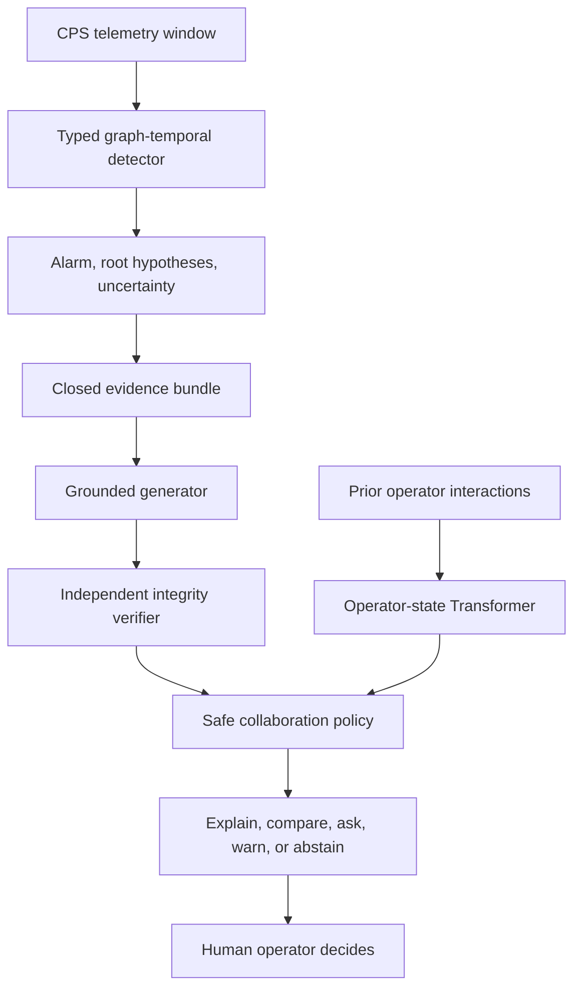

# CO-ACT-CPS

**Contestable and Co-Adaptive Generative AI for Human-AI Collaborative Incident
Diagnosis in Cyber-Physical Systems**

CO-ACT-CPS is a research implementation for studying a specific failure mode: an
industrial AI alarm can remain unchanged while the explanation shown to the operator
is manipulated. The project treats the explanation channel as a security boundary and
tests whether evidence verification plus adaptive human-AI collaboration improves safe
incident diagnosis.

This repository is a runnable research foundation, not a completed journal result.
Synthetic outputs validate software only. Publication claims require experiments on
HAI/SWaT, strong baselines, repeated seeds, adversarial evaluation, and an
ethics-approved human study.

## Research question

Can a CPS decision-support system detect explanation-channel manipulation and adapt
how it collaborates with an operator—showing evidence, alternatives, a warning, a
question, or abstention—without changing the underlying alarm and without taking
control away from the human?

## What is implemented

- A typed graph plus temporal Transformer detector for sensor-actuator windows.
- Two detector regimes: supervised classification and normal-only masked next-state
  prediction with validation-only anomaly-threshold calibration.
- Root-cause evidence ranking, Monte Carlo dropout uncertainty, and topology-aware
  representations.
- A closed-evidence explanation generator. Deterministic template mode is the
  reproducible default; a configurable Qwen text model is optional.
- Controlled explanation attacks: critical-evidence omission, confidence inflation,
  alternative hiding, and cause redirection.
- An independent verifier that checks evidence IDs, critical evidence, cause,
  uncertainty, alternatives, and permitted operator actions.
- An auditable safe collaboration policy plus an offline policy-training script with
  explicit verifier/uncertainty constraints.
- An operator belief/reliance Transformer and participant-held-out training script.
- A five-condition Streamlit human-study prototype with pseudonymous local logging.
- Generic CSV adapters and editable configurations for HAI 23.05 and SWaT.
- Unit tests and a synthetic end-to-end smoke test.

## Architecture



The system never sends actuator commands. The operator remains the final decision
maker.

## Step 1 — Open the project in VS Code on Windows

Install these first:

1. Python 3.11 (64-bit).
2. VS Code.
3. The VS Code Python extension.
4. Git and Git LFS if you will use HAI.

Extract the project, open VS Code, choose **File → Open Folder**, and select the
`co-act-cps` folder. Then open **Terminal → New Terminal** and run:

```powershell
py -3.11 -m venv .venv
Set-ExecutionPolicy -Scope Process -ExecutionPolicy Bypass
.\.venv\Scripts\Activate.ps1
python -m pip install --upgrade pip
python -m pip install -e ".[dev]"
```

For a CPU-only computer, you may install the smaller CPU PyTorch build first, then run
the editable-install command:

```powershell
python -m pip install torch --index-url https://download.pytorch.org/whl/cpu
python -m pip install -e ".[dev]"
```

For an NVIDIA GPU, use the command generated by
<https://pytorch.org/get-started/locally/> for your installed CUDA version.

In VS Code press `Ctrl+Shift+P`, choose **Python: Select Interpreter**, and select:

```text
.venv\Scripts\python.exe
```

If `py -3.11` is not found, install Python 3.11 and enable “Add Python to PATH.”
Python 3.13 is intentionally excluded because some research dependencies may lag it.

## Step 2 — Verify the installation

```powershell
python -m pytest
```

All tests should pass before you download a real dataset.

## Step 3 — Run the synthetic software check

```powershell
python scripts/run_demo.py --epochs 2 --n-steps 600 --output artifacts/demo
```

Expected files:

- `artifacts/demo/demo_results.json`
- `artifacts/demo/detector.pt`
- `artifacts/demo/adjacency.npy`
- `artifacts/demo/test_windows.npz`
- `artifacts/demo/synthetic_telemetry.csv`

Do not put synthetic metrics in the paper. They prove only that the pipeline runs.

## Step 4 — Get a real CPS dataset

### Recommended first dataset: HAI 23.05

HAI is publicly available from its official repository and uses Git LFS for recent
versions:

```powershell
git lfs install
git clone https://github.com/icsdataset/hai.git data/raw/hai_repo
Push-Location data/raw/hai_repo
git lfs pull
Pop-Location
```

The included HAI template targets `hai-23.05/hai-train*.csv` and
`hai-23.05/hai-test*.csv`. HAI's own documentation recommends time-series-aware
evaluation; add the official eTaPR implementation to the final reporting in addition
to this repository's window and episode metrics.

### Second dataset: SWaT

SWaT must be requested from SUTD iTrust. Do not redistribute it in this repository.
After accepting its terms, place the normal CSV file(s) under
`data/raw/swat/normal/` and the attack CSV file(s) under `data/raw/swat/attack/`.

Official pages:

- HAI: <https://github.com/icsdataset/hai>
- SWaT characteristics: <https://www.sutd.edu.sg/itrust/itrust-labs/datasets/dataset-characteristics/swat/>
- SWaT request form: <https://www.sutd.edu.sg/itrust/request-for-datasets/>

See `docs/dataset_setup.md` before preprocessing.

## Step 5 — Inspect columns before editing configuration

For HAI:

```powershell
python scripts/inspect_dataset.py data/raw/hai_repo/hai-23.05/hai-train1.csv
```

For SWaT, replace the path with your actual authorized CSV path. Confirm the label
column, numeric telemetry columns, timestamp, missing values, and file continuity.

## Step 6 — Prepare HAI windows

Copy the template and inspect the copy:

```powershell
Copy-Item configs/hai_template.yaml configs/hai.yaml
code configs/hai.yaml
python scripts/prepare_dataset.py --config configs/hai.yaml
```

The first development run may leave `features: null`; the adapter selects columns that
are at least 95% numeric. Before final experiments, replace `null` with an explicit,
version-controlled feature list and add physical/control topology edges from the HAI
technical manual or supplied graph data.

Prepared files appear in `data/processed/hai/`:

- `train.npz`
- `val.npz`
- `test.npz`
- `metadata.json`

The scaler is fitted only on the chronological training segment. Test data never fits
preprocessing parameters.

## Step 7 — Train the detector

```powershell
python scripts/train_detector.py --config configs/hai.yaml
```

The default HAI/SWaT mode is `normal_only`. It learns masked next-state prediction on
normal windows and calibrates its anomaly threshold only on validation-normal data.
Use `detection_mode: supervised` only for a clearly documented supervised ablation
with an episode-safe training split.

Outputs appear under `artifacts/hai/`:

- `detector.pt`
- `adjacency.npy`
- `test_metrics.json`

Never tune the anomaly threshold on the test attacks. Never randomly split overlapping
time windows. For final experiments, split by complete files, operating periods, and
attack episodes.

Run the included non-neural baselines under the same prepared split:

```powershell
python scripts/run_baselines.py `
  --data-directory data/processed/hai `
  --output artifacts/hai/baselines.json
```

These persistence and Isolation Forest results are minimum sanity checks. Add the deep
temporal and published dataset-specific baselines listed in the research protocol.

## Step 8 — Analyze one event

```powershell
python scripts/analyze_window.py `
  --checkpoint artifacts/hai/detector.pt `
  --adjacency artifacts/hai/adjacency.npy `
  --windows data/processed/hai/test.npz `
  --index 100 `
  --generator template
```

The JSON output contains the evidence bundle, operator-facing explanation, verifier
decision, and collaboration action.

## Step 9 — Evaluate explanation-channel attacks

```powershell
python scripts/evaluate_explanation_integrity.py `
  --checkpoint artifacts/hai/detector.pt `
  --adjacency artifacts/hai/adjacency.npy `
  --windows data/processed/hai/test.npz `
  --max-windows 500 `
  --output artifacts/hai/integrity_metrics.json
```

The main security quantities are integrity-attack detection rate, manipulation attack
success rate, clean-explanation false-alarm rate, and verification overhead. The
included transformations are controlled baselines; the final paper also needs an
adaptive red-team attack that optimizes against the verifier.

## Step 10 — Optional Qwen explanation model

The default is `Qwen/Qwen3-4B-Instruct-2507`, a text causal model that is easier to
reproduce than a multimodal model. The framework is model-agnostic: changing the LLM
must not change the detector or verifier.

First export evidence-grounded records:

```powershell
python scripts/export_evidence_corpus.py `
  --checkpoint artifacts/hai/detector.pt `
  --adjacency artifacts/hai/adjacency.npy `
  --windows data/processed/hai/train.npz `
  --output data/processed/explanations.jsonl `
  --max-records 2000
```

Domain experts must review these template targets. They are not automatically valid
training labels.

For inference only:

```powershell
python -m pip install -r requirements-llm.txt
python scripts/analyze_window.py `
  --checkpoint artifacts/hai/detector.pt `
  --adjacency artifacts/hai/adjacency.npy `
  --windows data/processed/hai/test.npz `
  --index 100 `
  --generator hf
```

For QLoRA fine-tuning, use an NVIDIA CUDA machine. WSL2/Linux or Colab is normally
more reliable than native Windows for `bitsandbytes`:

```powershell
python scripts/finetune_llm_qlora.py `
  --data data/processed/explanations.jsonl `
  --output artifacts/qwen-grounded-adapter
```

A 4B model is optional. Start with template mode and complete the detector/verifier
experiments first. Do not claim that fluent text is faithful; faithfulness is decided by
the independent verifier and measured experimentally.

## Step 10B — Frozen external-LLM red team

After the controlled and adaptive template attacks, use a separate generative model to
produce unseen truth-preserving rewrites. The protocol exports no ground-truth labels,
separates development and held-out tasks, fingerprints the frozen verifier, and reports
paired statistics with confidence intervals. Follow
[`docs/external_llm_redteam_step.md`](docs/external_llm_redteam_step.md). Do not inspect
held-out outcomes and then modify the verifier.

## Step 11 — Human-study prototype

Install and open the local interface:

```powershell
python -m pip install -r requirements-app.txt
python -m streamlit run apps/operator_study.py
```

Without the environment variable below, every row is marked `DEVELOPMENT_ONLY`:

```powershell
$env:COACT_ETHICS_APPROVAL="YOUR-ACTIVE-APPROVAL-REFERENCE"
```

Do not set a fake value. Do not recruit anyone before approval. Development rows are
for testing the interface and must not be mixed with research data.

After an approved study has enough repeated trials from multiple participants:

```powershell
python scripts/train_operator_model.py `
  --study-csv data/study/approved_trials.csv `
  --output artifacts/operator

python scripts/train_collaboration_policy.py `
  --study-csv data/study/approved_trials.csv `
  --output artifacts/policy
```

The policy script is an offline safety-constrained baseline, not proof of safe online
learning. Freeze the policy before confirmatory evaluation and use participant-held-out
analysis.

To test those two training scripts without people, generate explicitly simulated rows:

```powershell
python scripts/generate_development_study_data.py
python scripts/train_operator_model.py `
  --study-csv data/study/development_simulated.csv `
  --output artifacts/operator-development `
  --epochs 2
python scripts/train_collaboration_policy.py `
  --study-csv data/study/development_simulated.csv `
  --output artifacts/policy-development `
  --epochs 5
```

These outputs test code only and must never be reported as human evidence.

## Required publication experiments

1. HAI within-dataset detection and explanation-integrity evaluation.
2. SWaT replication with independently specified topology/invariants.
3. Time/episode-safe splits, at least five random seeds, confidence intervals, and
   corrected statistical comparisons.
4. Detector baselines: persistence/forecast residual, isolation forest, LSTM/TCN,
   Transformer, graph-temporal model without physics, and the full model.
5. Explanation baselines: raw alarm, feature attribution, unverified LLM, verified
   static explanation, and CO-ACT-CPS.
6. Adaptive attacks against evidence selection, causal claim, uncertainty, and
   operator recommendation while alarm output is held fixed.
7. Ablations for topology, physics loss, uncertainty, evidence authentication,
   counterfactual test, verifier rules, operator model, and adaptive policy.
8. Calibration, detection latency, episode metrics, root-cause ranking, integrity ASR,
   verifier overhead, and human decision outcomes.
9. An ethics-approved, preregistered human study or a narrower paper that makes no
   claims about human behavior.

The complete protocol is in `docs/research_protocol.md`.

## Repository map

```text
co-act-cps/
├── apps/                       # Streamlit operator-study prototype
├── configs/                    # Demo, HAI, and SWaT YAML configurations
├── data/                       # Raw, processed, and study data (not committed)
├── docs/                       # Research, threat, data, and human-study protocols
├── scripts/                    # Reproducible command-line experiment entry points
├── src/coact_cps/              # Models, data, generator, verifier, and pipeline
├── tests/                      # Unit and end-to-end smoke tests
├── pyproject.toml              # Package and dependency definition
└── README.md                   # Start here
```

## Scientific boundaries

- Static HAI/SWaT files can test detection and explanation manipulation, but they do
  not prove source-level cryptographic authenticity. Authentication must be emulated
  transparently or evaluated on an instrumented testbed.
- HAI/SWaT do not contain human interaction traces. Simulated operator logs are valid
  only for debugging.
- Root-cause tags may need to be derived from attack metadata and independently
  reviewed. Unknown roots must remain `-1`, not guessed.
- An LLM never bypasses the evidence gate and never operates actuators.
- Results must distinguish detector failures, generator failures, verifier failures,
  and operator outcomes.

## Next action

Run Steps 1–3. Then acquire HAI 23.05 and send the output of
`scripts/inspect_dataset.py` before changing the final feature list and topology.
